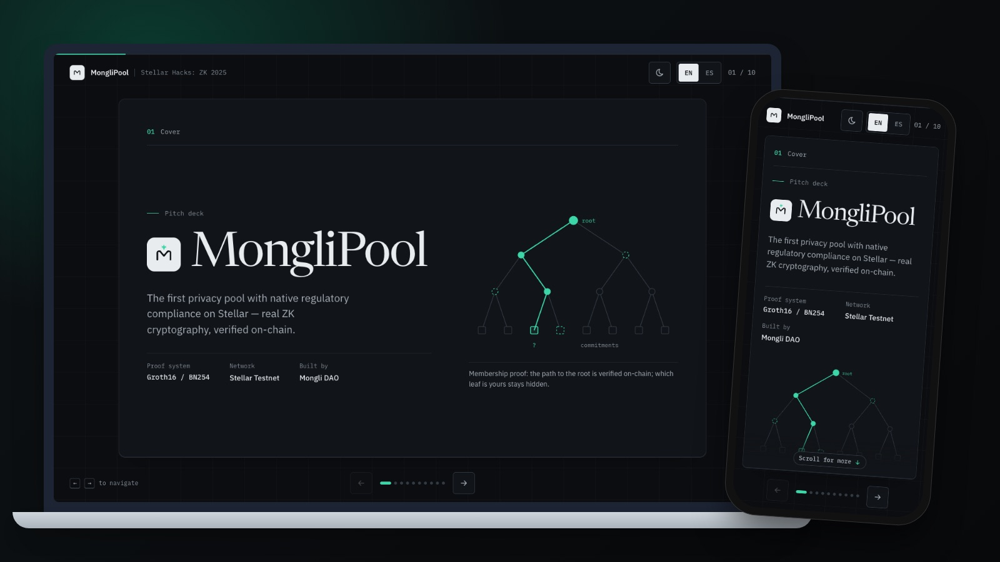
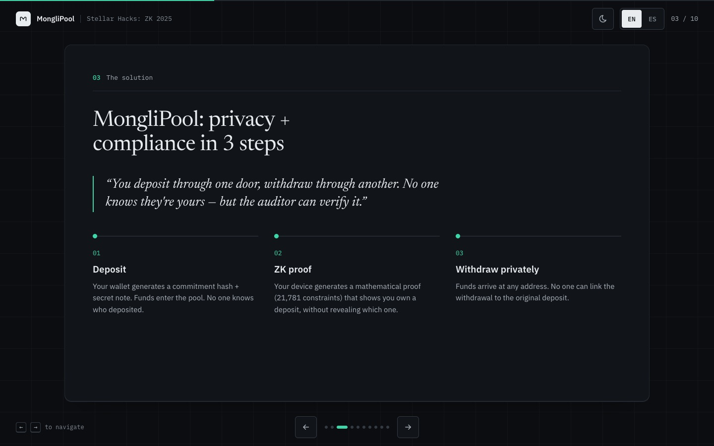
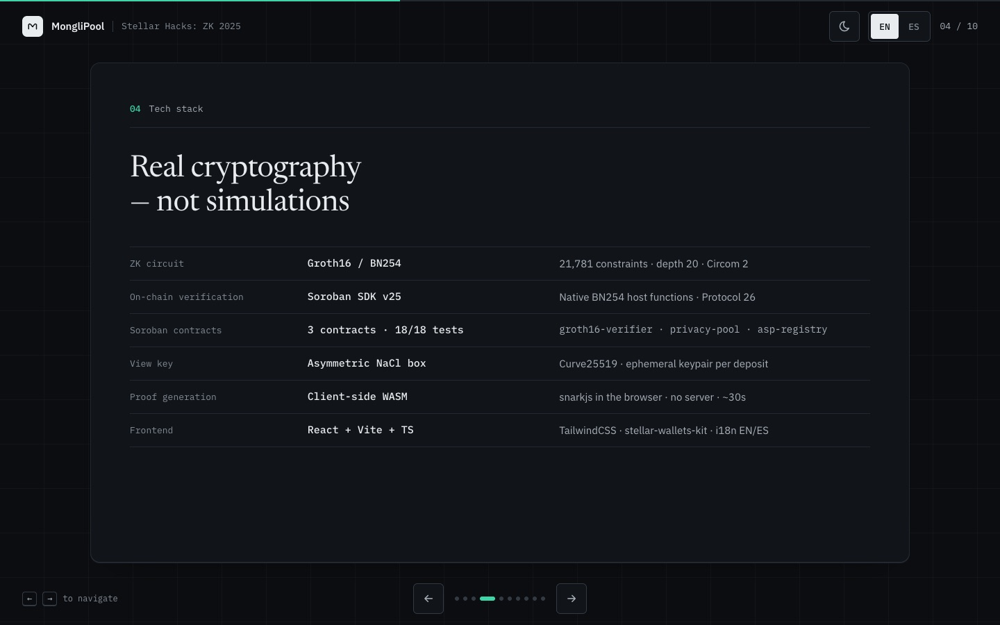
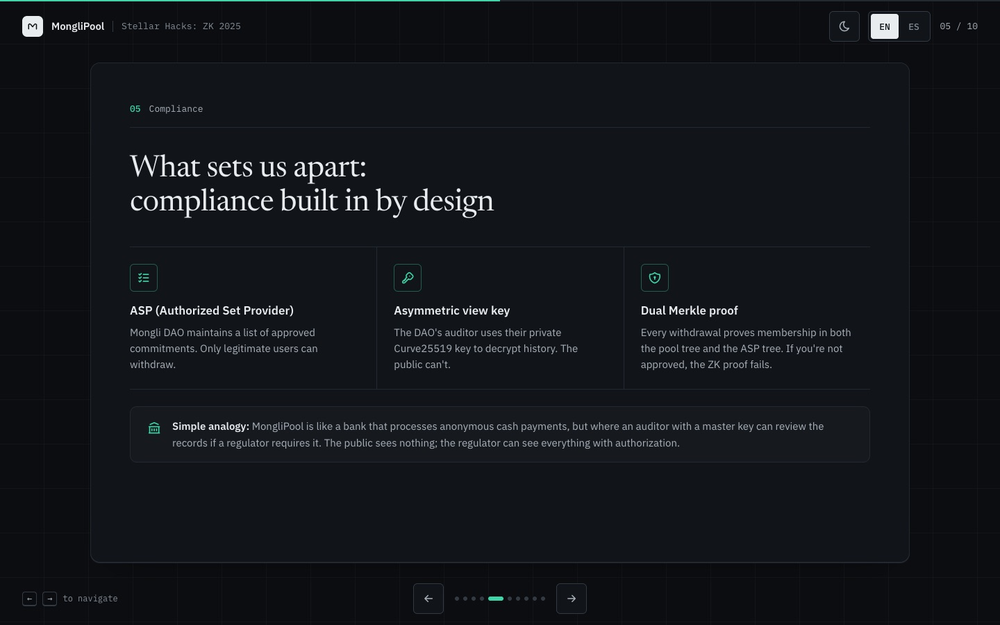
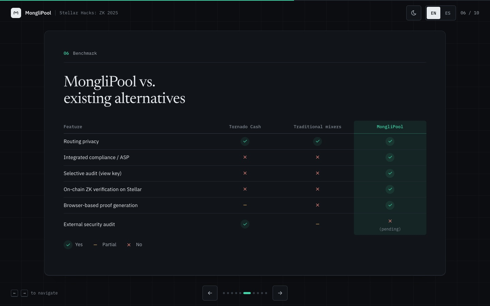
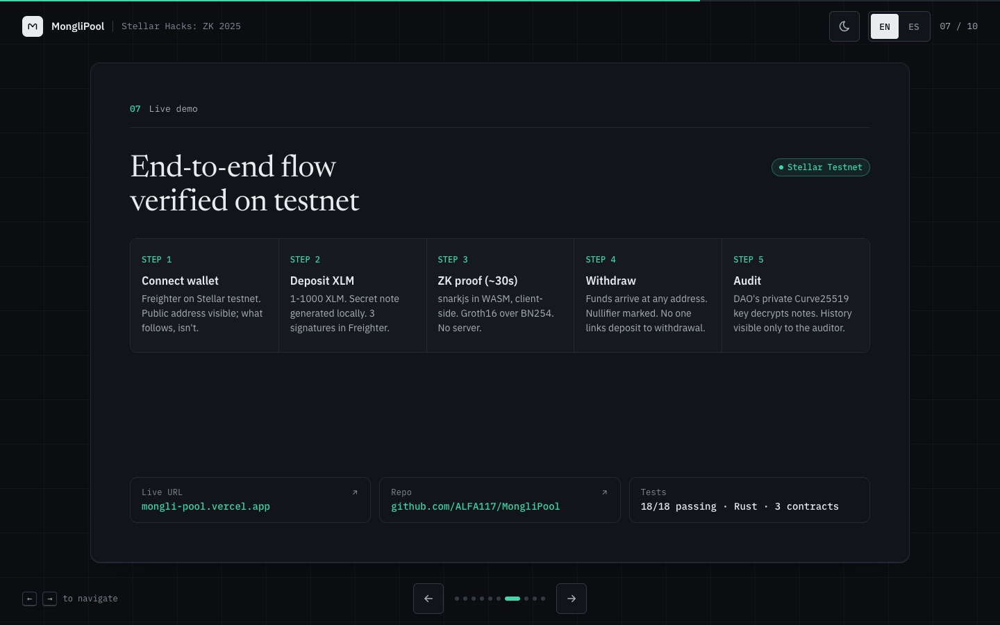
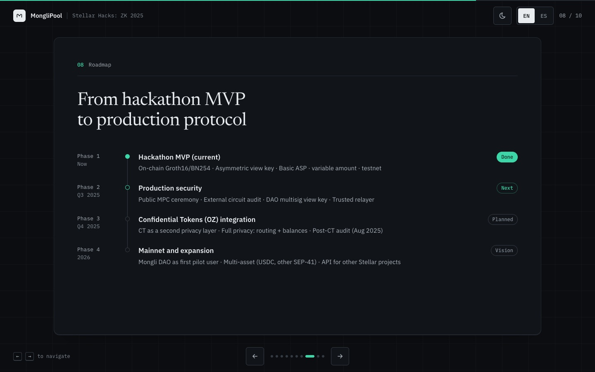
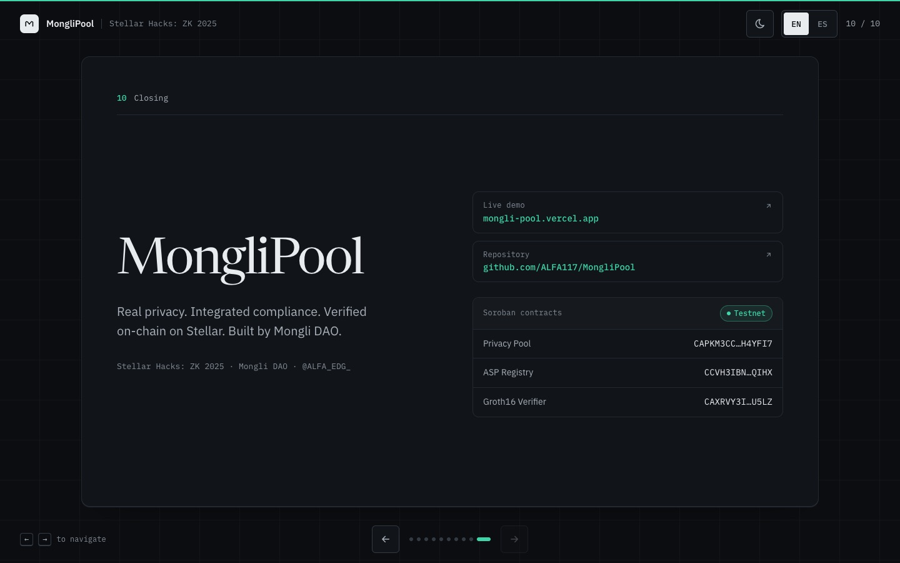
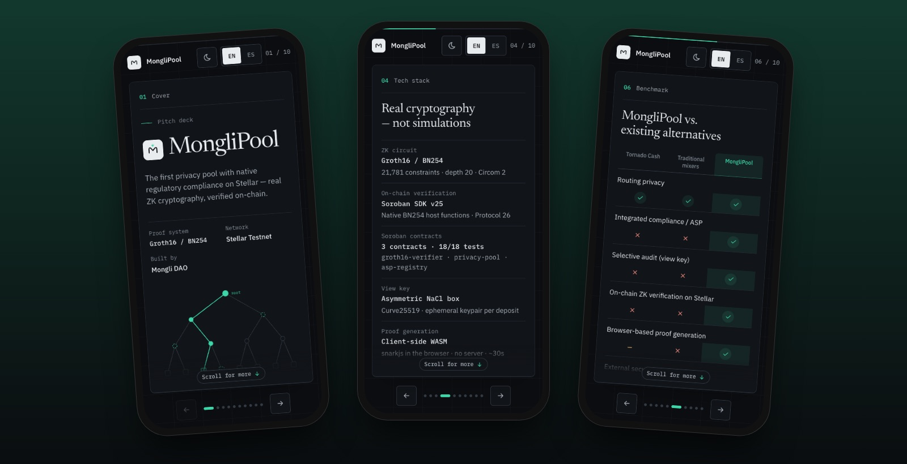
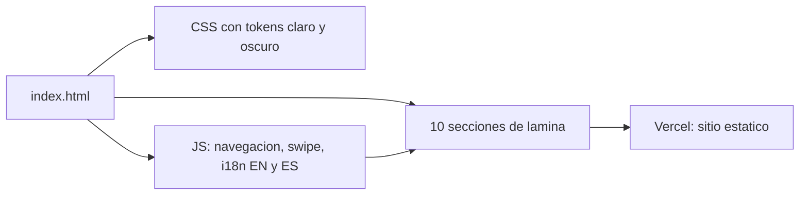

<div align="center">


# MongliPool — Pitch deck

### Las 10 láminas que cuentan MongliPool: privacidad con cumplimiento en Stellar, con criptografía ZK real.

[](https://presentacionde-monglipool.vercel.app)
[](https://mongli-pool.vercel.app)
[](https://github.com/ALFA117/MongliPool)
[](https://dorahacks.io/hackathon/stellar-hacks-zk)


<br/>



**[▶ Abrir el deck](https://presentacionde-monglipool.vercel.app)** · **[Probar MongliPool](https://mongli-pool.vercel.app)** · **[Código del producto](https://github.com/ALFA117/MongliPool)**

</div>

---

## 🎯 Qué es

El pitch de **[MongliPool](https://github.com/ALFA117/MongliPool)** — un pool de privacidad en Stellar con pruebas Groth16 verificadas on-chain en Soroban y un auditor autorizado con llave de vista — hecho para presentarlo a inversionistas y primeros usuarios. Todo vive en **un solo `index.html`** (HTML, CSS y JS puros, sin build), en inglés y español, con modo claro y oscuro.

## 🗂️ Las láminas

| # | Lámina | Qué cuenta |
|:--:|:--|:--|
| 01 | Portada | Árbol de Merkle con el camino de una hoja a la raíz: la prueba de pertenencia en una figura |
| 02 | El problema | En blockchain la privacidad y el cumplimiento no conviven |
| 03 | La solución | Privacidad + cumplimiento en 3 pasos: depositar, prueba ZK, retirar |
| 04 | Tecnología | Groth16/BN254, Soroban, 3 contratos, llave de vista NaCl, prueba en el navegador |
| 05 | Cumplimiento | ASP, llave de vista asimétrica y doble prueba de Merkle |
| 06 | Comparativa | MongliPool frente a Tornado Cash y mixers tradicionales |
| 07 | Demo | Flujo de punta a punta verificado en Stellar testnet |
| 08 | Roadmap | Del MVP del hackathon a un protocolo en producción |
| 09 | Equipo | Quién lo construyó |
| 10 | Cierre | Enlaces a la demo, al repo y registro de contratos en testnet |

<table>
<tr>
<td width="50%"><p align="center"><sub>02 · El problema</sub></p></td>
<td width="50%"><p align="center"><sub>03 · La solución</sub></p></td>
</tr>
<tr>
<td width="50%"><p align="center"><sub>04 · Tecnología</sub></p></td>
<td width="50%"><p align="center"><sub>05 · Cumplimiento</sub></p></td>
</tr>
<tr>
<td width="50%"><p align="center"><sub>06 · Comparativa</sub></p></td>
<td width="50%"><p align="center"><sub>07 · Demo</sub></p></td>
</tr>
<tr>
<td width="50%"><p align="center"><sub>08 · Roadmap</sub></p></td>
<td width="50%"><p align="center"><sub>10 · Cierre</sub></p></td>
</tr>
</table>

<div align="center">

<br/><sub>En el celular cada lámina se desplaza por dentro y se cambia con un swipe.</sub>
</div>

## ⌨️ Cómo se usa

| Acción | Cómo |
|:--|:--|
| Siguiente / anterior | `→` o `Espacio` / `←`, flechas en pantalla o swipe |
| Primera / última lámina | `Home` / `End` |
| Idioma | Botones EN / ES |
| Tema | Botón sol / luna |

## 🧩 Cómo está hecho



- Tipografía: Newsreader (títulos), IBM Plex Sans (cuerpo) e IBM Plex Mono (hashes y datos); íconos de Tabler.
- Movimiento discreto al cambiar de lámina, que se apaga con `prefers-reduced-motion`; controles de 44 px y `100dvh` para celular.
- Decisiones de diseño y checklist en celular: [docs/NOTAS-DE-DISENO.md](docs/NOTAS-DE-DISENO.md).

## 🚀 Correrlo

No hay nada que instalar: abre `index.html` en el navegador, o sírvelo localmente.

```bash
git clone https://github.com/ALFA117/presentacionde-Monglipool.git
cd presentacionde-Monglipool
npx serve .        # o: python3 -m http.server
```

## 🔗 Producto relacionado

**[ALFA117/MongliPool](https://github.com/ALFA117/MongliPool)** — el código del pool (circuito Circom, contratos Soroban y frontend) y la [app en vivo](https://mongli-pool.vercel.app).

## 📄 Licencia

MIT — ver [`LICENSE`](LICENSE).

---

<div align="center">

**Privacidad real. Cumplimiento integrado. Verificado on-chain en Stellar.**

Hecho por Mongli DAO para **Stellar Hacks: ZK 2025**.

</div>
